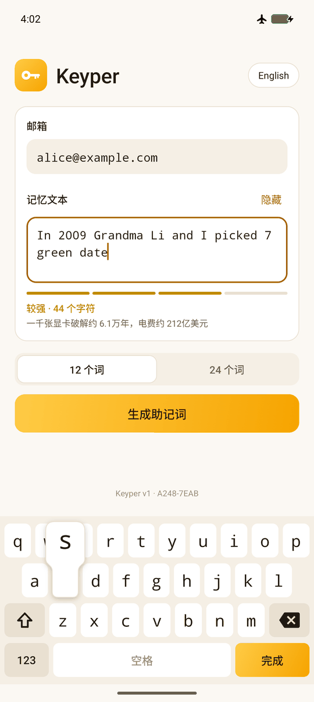
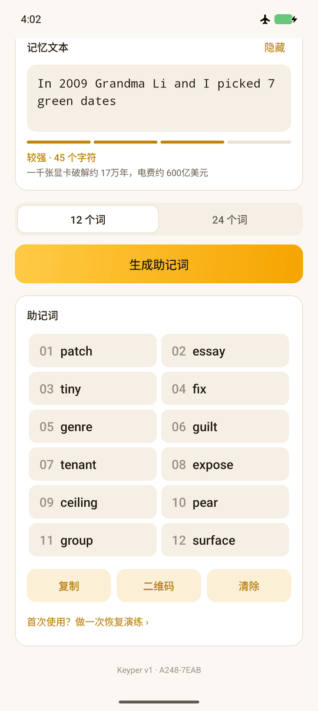
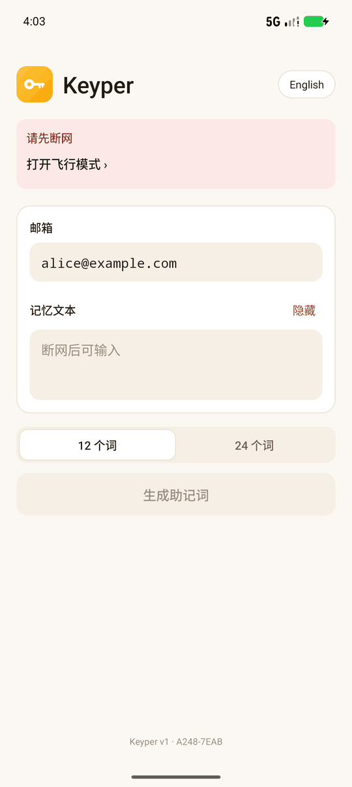

# Keyper

**记在脑子里的助记词。** 在一台离线的 Android 手机或 iPhone 上，用**邮箱 + 一句只有你记得的话**生成标准 BIP39 助记词。
同样的输入永远得到同样的助记词：不用抄写，App 也什么都不存。

[English](README.md) · 简体中文

<p align="center">
  
  
  
</p>
<p align="center"><sub>以上为 Android 版；iPhone 版界面相同，同样的输入得到同样的助记词（截图见 <a href="README.md">English README</a>）。</sub></p>

- **标准输出**：12 或 24 个词的 BIP39 助记词，任何钱包都能用。
- **难以暴力破解**：每猜一次都要跑一遍 Argon2id（1 GiB 内存 × 128 遍），骁龙 870 上约 1 分钟。
  约 48 位熵的一句话，攻击者光电费就超过 1 亿美元。
- **自带专用键盘**：邮箱和记忆文本都只能用 Keyper 自己的键盘输入，系统输入法完全接触不到，无从学习、同步或上传。
- **断网门禁**：飞行模式打开、WiFi 和蓝牙都关闭时才能输入和生成；一旦联网立即清除。
- **零权限、零存储**：两个平台都不联网、不读写存储、零第三方运行时依赖；Android 版 APK 约 95 KB，iOS 版不到 1 MB。
- **恢复演练**：生成后凭记忆再输一遍，当场确认将来能恢复。
- **协议公开**：[SPEC.md](SPEC.md) 精确定义了算法（v1 已冻结），独立的 [Python 实现](reference/keyper.py)可以复现。

需要 Android 8.1（API 27）或 iOS 17 及以上，4 GB 以上内存。中英双语。两个平台用同样的输入得到同样的助记词。

## 原理

```
邮箱 ──── 只留英文字母和数字、转小写 ───────────────────────────┐ (盐)
记忆文本 ─ 合并多余空格 ─ HMAC-SHA256(域常量) ─ Argon2id(1 GiB × 128 遍) ─ K ─┬─ HMAC ─ 12 个词
                                                                              └─ HMAC ─ 24 个词
```

- **记忆文本只认 80 个字符**：26 个英文字母（大小写）、10 个数字、18 个符号 `! @ # $ % ^ & * ( ) . , ? - _ + = /`。
  大小写、符号和词之间的空格都算数，多打的空格（连续空格、首尾空格）不算。没有引号、`|`、`\`、`:`、`;` 这类容易看错的符号。
  中文用拼音写，比如 `Wo de di yi zhi mao jiao MiMi!`。
- **邮箱只是盐**：大小写、点、横线、空格都不影响，`138-0000-0000` 和 `13800000000` 是同一个。也可以用手机号。
- **12 词和 24 词互相独立**，知道一个推不出另一个。
- **域常量**：写在 [`Domain.kt`](app-android/app/src/main/kotlin/app/getkeyper/Domain.kt) 里的 32 字节随机数，
  让同一句话在不同部署里得到不同结果。它随 App 公开，不是秘密。

“邮箱 + 秘密”是这类工具的标准做法（WarpWallet 也用邮箱作盐）。邮箱不是秘密：它让同一句话在不同人那里得到无关的助记词，
攻击者只能一个人一个人地猜，没法一张表打所有人。同一个邮箱可以配多句不同的话，各得一组助记词。没有账户，也没有索引。

### 自带键盘

```
字母层                          数字符号层
q w e r t y u i o p            1 2 3 4 5 6 7 8 9 0
 a s d f g h j k l             ! @ # $ % ^ & * ( )
⇧ z x c v b n m ⌫              . , ? - _ + = /  ⌫
123 [   空格   ] 完成           ABC [   空格   ] 完成
```

- 每台手机上一模一样：固定 QWERTY、固定尺寸（不随系统字体缩放）、等宽字体（`0`/`O`、`1`/`l`/`I` 一眼可辨）。
  输入邮箱时底行多出 `@` 和 `.`，“完成”变成“下一项”。
- 手感像 iPhone 键盘：键盘上每一点都归最近的键，点在缝隙里也不会落空；按下时手指上方弹出放大的字符，
  抬起才输入，按偏了可以滑到正确的键再松手；另一根手指按下时前一个键立即输入，双拇指快打不乱序。⇧、⌫ 和 123 按下即生效。
- ⇧ 点一次只管下一个字，连点两次锁定大写；按住 ⌫ 连删；Back 收起键盘；在键盘上从屏幕边缘滑动不会触发返回。
- 光标是系统原生的：点按定位，拖动光标（或手柄）移动，带放大镜。
- 两个输入框都不给系统输入法任何连接，粘贴、长按菜单、拖放、实体键盘和注入的按键都进不来。

## 安全模型：务必读完

| 别人拿到了… | 还剩什么在保护你 |
|---|---|
| 只有你的记忆文本 | 你的邮箱；App 从未外传时还有域常量 |
| App 和你的邮箱 | 记忆文本有多难猜：每猜一次都要 1 GiB × 128 遍 |
| App、邮箱和记忆文本 | 没有了，这三样加起来就是助记词 |

1. **App 一旦外传，域常量就等于公开。** 真正扛住暴力破解的，只有记忆文本难不难猜。
2. **难猜不等于字多。** 名句、歌词、俗语、“我的猫叫某某”这类模板，攻击者最先试，几块钱电费就能命中。
   要用只有你知道的具体细节：人名、年份、地点、数字，再加一两个符号。

   | 难猜程度 | 一千张顶级显卡 | 光电费 |
   |---:|---:|---:|
   | 30 位 | 7.5 小时 | 300 美元 |
   | 40 位 | 320 天 | 30 万美元 |
   | 50 位 | 890 年 | 3.1 亿美元 |
   | 60 位 | 91 万年 | 3200 亿美元 |

   App 输入时会按这个模型估算（偏向攻击者，见 [SPEC.md §4](SPEC.md#4-security-model)），低于 1 亿美元会弹窗提醒，但认不出名句，所以别用名句。
3. **先做恢复演练，再往钱包里转钱。** 生成后点“首次使用？做一次恢复演练”，凭记忆再输一遍，一致才算数。
4. **域常量丢了或被改了，所有人的助记词都无法再生成。** 见“构建与维护”。

App 内的其他保护：离开 App 立即清空记忆文本和助记词；复制的助记词 60 秒后离开剪贴板；不允许自动填充服务读取。

- **Android**：禁止截屏和录屏（二维码页面也是），最近任务里是空白；记忆文本、助记词区域和键盘对读屏类恶意软件不可见（Android 14+）；复制的助记词标记为敏感。
- **iOS**：系统没有 FLAG_SECURE，所以整个界面画在 iOS 不会截进截屏、录屏和投屏的那一层里（安全输入框的容器，没有公开 API）；
  离开 App 时有遮罩，多任务界面里看不到内容；复制的助记词只留在本机（不进通用剪贴板），App 被关掉也会按时过期。

**断网门禁**在前台每 0.5 秒检查一次，都不需要权限：

- **Android** 读取飞行模式、WiFi 设置和蓝牙适配器的实时状态；未满足的每一项都能点，直接跳到对应的系统设置页。
  **小米 / 红米（HyperOS）**：控制中心的蓝牙按钮只断开新连接，蓝牙其实还开着，要在“设置 → 蓝牙”里关掉最上面的开关。
- **iOS** 不让 App 读取飞行模式和 Wi-Fi 开关：门禁要求没有任何网络接口拥有超出本地链路的地址（用 `getifaddrs` 读取），且蜂窝射频已关。
  它刻意不用 Network 框架：在国行 iPhone 上，那会让系统弹出“是否允许使用无线数据”，而用户点“不允许”又会被误判为已断网。
  它看不到“Wi-Fi 开着但没连任何网络”的情况；读取蓝牙需要申请权限，所以只提醒你关掉。iOS 不允许 App 打开这些设置页，所以各项是文字说明。

完整的安全审计和“什么情况下助记词会被算出来”见 [docs/security-audit-zh.md](docs/security-audit-zh.md)；
报告安全漏洞见 [SECURITY.md](SECURITY.md)。

## 使用

1. 打开飞行模式，关闭 WiFi 和蓝牙。
2. 用 Keyper 的键盘输入邮箱，按“下一项”，再输入那句话（点“显示”可核对）。
3. 选 12 或 24 个词，点“生成助记词”，等约一分钟。
4. 第一次用这句话时，做一次恢复演练。
5. **复制**到同一台手机的钱包 App（60 秒后清空），或用**二维码**给另一台设备扫描。
6. 页脚显示构建的域指纹（本仓库为 `A248-7EAB`）。指纹一样，助记词就一样；指纹变了就**不要用**，先弄清原因。

## 构建与维护

### Android

需要 JDK 17+ 和 Android SDK（compileSdk 36）。

```sh
cd app-android
./gradlew :core:test :app:testDebugUnitTest :app:lintDebug :app:assembleRelease
# 输出 app/build/outputs/apk/release/app-release.apk
```

发布签名读取 `app-android/keystore.properties`（storeFile / storePassword / keyAlias / keyPassword，已被 git 忽略）；没有时 release 用 debug key 签名。

### iOS

需要 Mac 上的 Xcode 26。

```sh
cd app-ios/KeyperCore && swift test -c release   # 协议核心，含 SPEC 的 1 GiB 向量
cd app-ios && xcodebuild -scheme Keyper -destination 'platform=iOS Simulator,name=iPhone 17' test
```

在真机上运行请用 Xcode 打开 `app-ios/Keyper.xcodeproj`，签名换成你自己的团队。核心是只依赖系统 CryptoKit 的 Swift 包；
界面用 SwiftUI，键盘、输入框和防截屏层用 UIKit。工程使用同步文件夹，新增文件不用改工程文件。
Debug 构建另外接受 `-KeyperSimulateOffline`、`-KeyperAllowScreenshots`（UI 测试用）和 `-KeyperBench`（真机测速）；正式版里没有这些开关。

### 两个平台通用

核心测试会用完整的 1 GiB Argon2id 跑 SPEC 的测试向量，需要几分钟。

- **协议已冻结。** `KeyperTest.protocolV1IsFrozen`（以及它的 Swift 版本）钉死了所有协议常量，SPEC 的测试向量钉死了结果；
  任何改变 v1 结果的改动都会让测试失败。两个核心读取 [`test-vectors/`](test-vectors) 里同一套夹具。
- **域常量永远不能改**：[`Domain.kt`](app-android/app/src/main/kotlin/app/getkeyper/Domain.kt) 和
  [`Domain.swift`](app-ios/Keyper/Domain.swift) 里各有一份（指纹 `A248-7EAB`），测试钉死指纹并保证两份相同。
  源码仓库和发出去的每个 App 都要离线备份多份，它们都含有域常量。
- **自己部署一套？** 在任何人使用前用 `openssl rand -hex 32` 换掉两个文件里的域常量，并更新指纹测试。不同部署的助记词互不相干。
- 正式分发前用自己的密钥签名，并公布签名证书的 SHA-256。
- 用 SPEC 的测试域常量构建时，界面顶部显示红色“测试构建”警告。
- **上架应用市场**：更新会自动推送，新版本加权限也不会询问用户，所以开发者账号就是信任链的一环：务必开两步验证；
  离线手机上的 Keyper 建议关闭自动更新。只从官方渠道安装：仿冒包可以显示同样的指纹和结果，同时记录你的输入。
  Google Play 的加密货币政策只针对托管类服务，Keyper 不碰资产，但提交前在 Play Console 再确认。
  2023 年 11 月后注册的个人开发者账号，要先做至少 12 名测试者、连续 14 天的封闭测试。

### 脱离 App 恢复

有域常量就能用独立的 Python 参考实现算出助记词（电脑上约 25 秒）：

```sh
pip install -r reference/requirements.txt
python3 reference/keyper.py --domain-file app-android/app/src/main/kotlin/app/getkeyper/Domain.kt --words 12
python3 reference/keyper.py --self-test    # 核对 SPEC.md 的测试向量
```

## 验证情况

| 项目 | 方法 | 结果 |
|---|---|---|
| Argon2id / BLAKE2b | RFC 9106、RFC 7693 向量；48 组随机参数对照 argon2-cffi（RFC 参考 C 实现） | 全部一致 |
| BIP39 | 词表 SHA-256；Trezor 官方 24 组向量 | 全部一致 |
| 二维码 | 对照 segno 逐模块比较 40 个版本 × 8 种掩码；zxing-cpp 解码 42 个真实助记词和 App 截图 | 全部一致 / 全部解出 |
| 协议 | Kotlin 与 Python 参考实现（argon2-cffi + Trezor mnemonic）对 SPEC 的 7 组向量；模拟器上的 App 与 Python 参考实现（真实域常量）对照 | 一致 |
| 冻结守卫 | 协议常量、域常量指纹各有测试钉死 | 通过 |
| 测试有效性 | 人为植入错误（Argon2、二维码掩码、中断时的线程等待） | 对应测试均失败 |
| 自带键盘 | 模拟器上用自带键盘输入各类字符；点在键缝和边缘；滑动纠正；用真实多点触控事件测双指交替 | 符合设计 |
| 键盘流畅度 | 同样输入 30 个字符时的渲染帧（模拟器） | 帧数 255 → 33，帧耗时中位数 34 ms → 18 ms |
| 切换语言 | 输入了邮箱、记忆文本并生成助记词后切换中英文 | 进程不重建，全部内容保留 |
| 输入隔离 | 输入框获得焦点时系统输入法状态；adb 注入文字和按键 | 系统输入法从不弹出；注入全部被拦下 |
| 恢复演练 | 先输错一个字，再输对 | 提示不一致；一致时重新显示助记词 |
| 大字体 | 系统字体 1.6 倍下显示 24 个词 | 每个词完整显示 |
| 取消与中止 | 计算中点“取消”、按 Home、打开 WiFi | CPU 2 秒内从 300%+ 降到 0，无崩溃 |
| 断网门禁 | 模拟器（API 36、30）和 Redmi K40（HyperOS）上逐项切换 | 未断网时不能输入和生成；联网立即清除；蓝牙“半开”能正确识别 |
| 内存 | Java 堆上限 192 MB 的模拟器连续生成 8 次 | 每次都释放 |
| 截屏 / 权限 | 设备内 `screencap`；合并后的 manifest | 黑屏；0 个权限 |
| iOS 核心 | 同一套夹具和 SPEC 的 7 组向量（`swift test -c release`） | 全部一致 |
| iOS App | 模拟器上用自带键盘逐键输入、生成，与 Python 参考实现（真实域常量）逐词比对；二维码、恢复演练、切换语言、离开 App、弱口令和过短输入、断网门禁各有 UI 测试 | 一致；符合设计 |
| iOS 键盘 | 多指单元测试：双指交替、滑动纠正、键缝和边缘、按住删除时另一指打字 | 符合设计 |
| iOS 文案 | 紧凑数字对照 ICU 本身（test-vectors/compact.tsv）；强度文案对照 Android 版 | 一致 |
| iOS 真机 | iPhone 11（iOS 26.5）：用自带键盘输入、生成，与 Python 参考实现比对；运行中截图；开着防截屏切后台再回来三次；全新安装 | 一致；截图里只有背景色；无崩溃；不弹任何系统询问 |
| iOS 断网门禁 | iPhone 11 开飞行模式、Wi-Fi 连着，再关掉 Wi-Fi，全程 USB 连着 Mac | 先拦截（界面已核对），后放行；USB 链路和苹果的设备隧道不计入 |
| iOS 权限 | 编出的 Info.plist 和链接的库 | 没有权限说明、没有后台模式；只链接系统框架 |

Argon2id 耗时（1 GiB × 128 遍，4 路）：Redmi K40（骁龙 870）App 正式版 64.6 秒，满载一分钟未见降频；iPhone 11（A13）约 72 秒；
桌面 JVM（M2 Pro）约 22 秒；Swift（M2 Pro）约 25 秒；argon2-cffi（参考 C 实现，M2 Pro）约 25 秒。
复现：`./gradlew :core:test`、`./gradlew :core:bench`；手机上用 debug 包跑
`adb shell 'CLASSPATH=$(pm path app.getkeyper.private | cut -d: -f2) app_process / app.getkeyper.DeviceBenchKt'`。
测试夹具由 `reference/make_fixtures.py` 从上述独立实现生成。

## 已知限制

- 域常量能从 App 中提取，不是秘密。
- 强度估算是启发式的，认不出名句和公开的个人信息。
- 拼写要多年前后一致（大小写、符号、拼音的 `zh`/`z`、`ü` 写成 `v` 还是 `u`）。恢复演练能当场发现错误，几年后的记忆偏差只能靠用户自己。
- Android 上剪贴板 60 秒清除依赖 App 进程还活着；划掉 App 后，Android 13+ 系统约 1 小时后自己清，更早的版本会一直留着（iOS 由系统按时让它过期）。
  第三方输入法或厂商的剪贴板历史可能另存一份：优先用二维码，或手动抄写。
- 断网门禁防误操作，不是隔离保证。Android 上只看飞行模式、WiFi、蓝牙，覆盖不到 USB 网络共享、有线网卡、NFC；
  iOS 上看网络接口和蜂窝射频，看不到“Wi-Fi 开着但没连网”，也看不到蓝牙。
- iOS 的防截屏依赖系统绘制安全输入框的方式，这不是公开 API；如果以后的 iOS 改了，App 照常可用，只是没有这层保护。
- 读屏类恶意软件的防护依赖 Android 14+ 的敏感数据标记；更老的系统上，离线手机本身要干净。
- Kotlin 和 Swift 的字符串都无法可靠擦除；1 GiB 的计算内存用完即交还内核。威胁模型不包括内存取证。
- 需要 4 GB 以上内存；没在 32 位或真实低端机上实测，比 K40 慢的手机预计要几分钟。
- 包名 `app.getkeyper.private` 中的 `private` 是 Java 关键字，所以代码命名空间用 `app.getkeyper`。
- targetSdk 36；Android 17（API 37）的行为变化还没评估。

## 目录

```
SPEC.md                     协议规范（v1 已冻结）、设计理由、测试向量
SECURITY.md                 如何报告安全漏洞
docs/security-audit-zh.md   冻结前的安全审计、攻击场景、残余风险（英文版 security-audit.md）
reference/keyper.py         独立的 Python 参考实现（交叉验证、脱离 App 恢复）
reference/make_fixtures.py  从独立实现生成测试夹具
test-vectors/               两个核心共同使用的测试夹具
app-android/core/           纯 Kotlin/JVM：协议、Argon2id、BLAKE2b、BIP39、二维码、强度估算
app-android/app/            Android 界面：自带键盘、断网门禁、恢复演练（只用平台控件）
app-ios/KeyperCore/         Swift 包：同一套核心的 Swift 实现，基于系统 CryptoKit
app-ios/Keyper/             iOS 界面：SwiftUI，键盘、输入框和防截屏层用 UIKit
```

## 参与贡献

欢迎报告问题、改进翻译和界面。协议已冻结：任何改动都不能改变 v1 的结果。详见 [CONTRIBUTING.md](CONTRIBUTING.md)。

## 许可证

Copyright © 2026 Shelchin。Keyper 以 [MIT 许可证](LICENSE) 开源。
