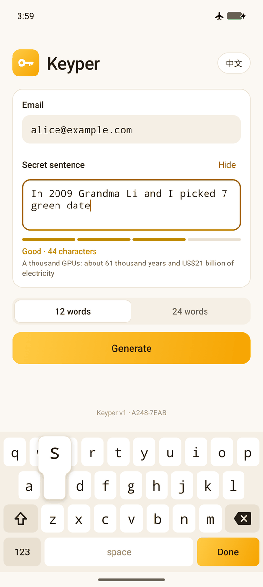
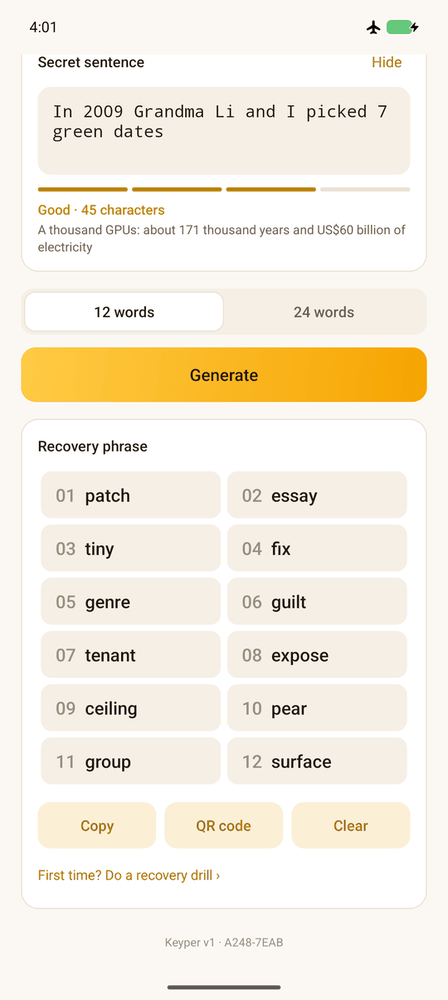
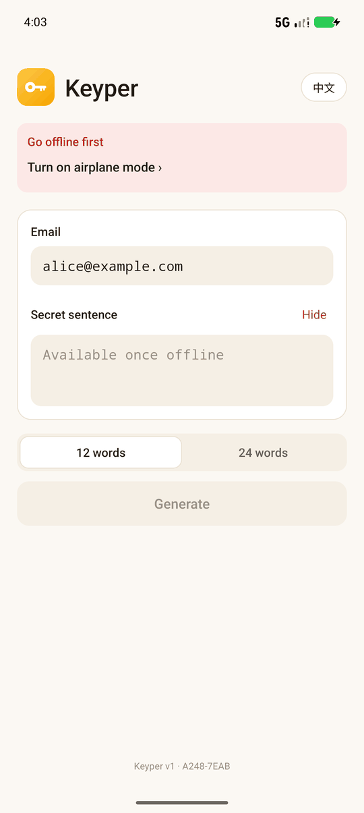
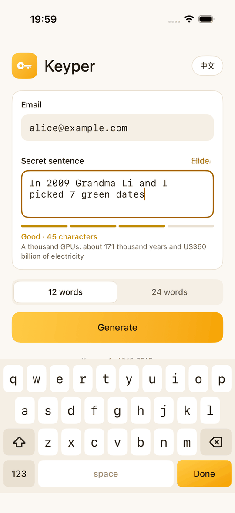
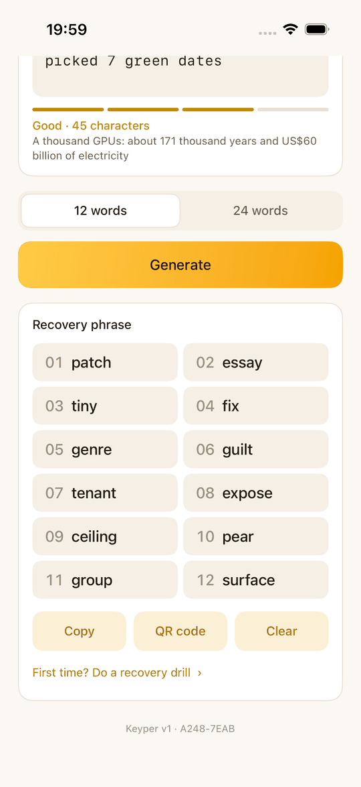
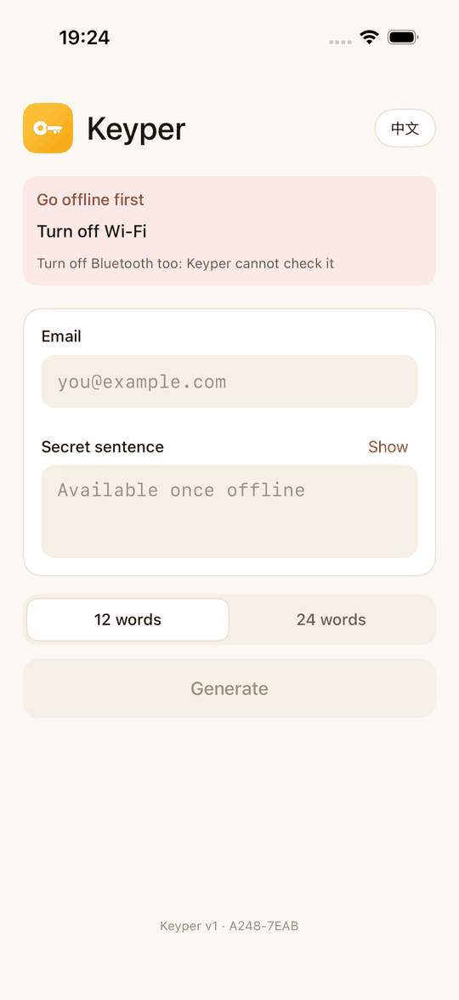

# Keyper

**A recovery phrase you keep in your head.** On an offline Android phone or iPhone, Keyper turns your
email and a sentence only you know into a standard BIP39 recovery phrase. The same inputs always
give the same phrase, so you do not need to write it down. Keyper stores nothing you type.

Coming to Google Play and the App Store for US$29.99, paid once. Building it yourself from this
repository is free and gives the same app.

[getkeyper.app](https://getkeyper.app) · English · [简体中文](README-zh.md)

<p align="center">
  
  
  
</p>
<p align="center">
  
  
  
</p>
<p align="center"><sub>Android above, iPhone below: the same inputs give the same phrase.</sub></p>

- **Standard output.** BIP39 phrases of 12 or 24 words, usable with any wallet.
- **Expensive to guess.** Every guess costs an Argon2id run over 1 GiB of memory, 128 passes:
  about a minute on a Snapdragon 870. Above about 48.4 bits of entropy in the sentence,
  the attacker's electricity bill alone passes US$100 million.
- **Its own keyboard.** Both fields are typed only on Keyper's keyboard. The system keyboard
  never connects, so it cannot learn, sync or upload what you type.
- **Offline gate.** You can only type and generate with airplane mode on and Wi-Fi and
  Bluetooth off (iOS lets apps check only the network, so there Bluetooth is a reminder). Going
  back online wipes everything at once, the clipboard included.
- **No permissions.** Neither app asks for a permission or uses the network, and neither bundles
  a library beyond the system's own (and, on Android, the Kotlin standard library). The Android APK is about 95 KB, the iOS app well under 1 MB.
- **Recovery drill.** Re-type both inputs from memory and check on the spot that they give the
  same phrase.
- **Open protocol.** [SPEC.md](SPEC.md) defines the derivation exactly (v1 is frozen), and an
  independent [Python implementation](reference/keyper.py) reproduces it.

Android 8.1 (API 27) or later, or iOS 17 or later, with 4 GB of RAM or more. English and
Chinese.

## How it works

```
email ──── keep ASCII letters and digits, lowercase ──────────────┐ salt
sentence ─ collapse extra spaces ─ HMAC-SHA256(domain) ─ Argon2id(1 GiB × 128) ─── K ─┬─ HMAC ─ 12 words
                                                                                      └─ HMAC ─ 24 words
```

- **The sentence uses 80 characters**: `A`–`Z`, `a`–`z`, `0`–`9` and 18 symbols
  `! @ # $ % ^ & * ( ) . , ? - _ + = /`. **Case, symbols and the spaces between words count**;
  extra spaces (runs of spaces, spaces at either end) do not. There are no quotes, `|`, `\`,
  `:` or `;`, which are easy to mistype or misread. Write other languages in Latin
  letters, for example Chinese in pinyin: `Wo de di yi zhi mao jiao MiMi!`
- **The email is only a salt, and unlike the sentence it forgives.** Only its ASCII letters and
  digits count, regardless of case, so `Alice@Example.com` and `alice@example.com`, or
  `138-0000-0000` and `13800000000`, are the same. A phone number works as well.
- **12 and 24 words are independent.** Knowing one tells nothing about the other.
- **The domain constant** is 32 random bytes in
  [`Domain.kt`](app-android/app/src/main/kotlin/app/getkeyper/Domain.kt) and
  [`Domain.swift`](app-ios/Keyper/Domain.swift). It makes the same
  sentence give different phrases in different deployments. It ships inside the app, so it
  is public.

The email-as-salt construction is the standard one (WarpWallet uses it too): the same sentence
gives unrelated phrases for different people, and an attacker has to attack one person at a
time. One email can go with several sentences, each giving its own phrase.

### The keyboard

```
letters                         digits and symbols
q w e r t y u i o p            1 2 3 4 5 6 7 8 9 0
 a s d f g h j k l             ! @ # $ % ^ & * ( )
⇧ z x c v b n m ⌫              . , ? - _ + = /  ⌫
123 [   space   ] Done          ABC [   space   ] Done
```

- Identical on every phone: fixed QWERTY, fixed sizes that ignore the system font scale, and a
  monospace face that tells `0`/`O` and `1`/`l`/`I` apart. The email gets `@` and `.` on the
  bottom row and a Next key.
- Touch works as on the iPhone. Every point belongs to its nearest key, so taps between keys
  still type. The key under your finger pops up magnified and types when you lift, so you can
  slide to the right key first. A second finger landing types the first one's key at once, so
  fast two-thumb typing keeps its order. ⇧, ⌫ and 123 act on touch-down.
- ⇧ once for one capital, twice for caps lock; hold ⌫ to keep deleting; Back closes the
  keyboard. Edge swipes over the keyboard are not taken as Back.
- The cursor is the system's own: tap to place it, drag it (or its handle) to move it, with the
  magnifier.
- The fields give the system keyboard no connection at all. Paste, the long-press menu,
  drag-and-drop, hardware keys and injected key events are all blocked.

## Security model

The code and the domain constant are public: assume every attacker has them.

| An attacker has… | What still protects the phrase |
|---|---|
| your email | how hard your sentence is to guess: every guess costs 1 GiB × 128 passes |
| your sentence | only your email, which is usually not a secret |
| your email and your sentence | nothing: together they are the phrase |

1. **Length does not make a sentence hard to guess.** Famous lines, lyrics, proverbs and templates like
   "my cat is called X" are an attacker's first guesses and fall for a few dollars of
   electricity. Use details only you know: names, years, places, numbers, a symbol or two.

   | Entropy of the sentence | 1000 top GPUs | Electricity alone |
   |---:|---:|---:|
   | 30 bits | 7.5 hours | US$300 |
   | 40 bits | 320 days | US$305,000 |
   | 50 bits | 890 years | US$313 million |
   | 60 bits | 910,000 years | US$320 billion |

   The app estimates this while you type, using assumptions that favour the attacker
   ([SPEC.md §4](SPEC.md#4-security-model)). Below US$100 million it warns you before
   generating, but it cannot recognise famous lines, so don't use one.
2. **Do the recovery drill before you use the phrase.** After generating, tap "First time? Do a
   recovery drill" and re-type both inputs from memory.
3. **If the domain constant is lost or changed, no phrase can ever be regenerated.** See
   [Building and maintaining](#building-and-maintaining).

Other protections: leaving the app wipes the sentence and the phrase, a copied phrase leaves the
clipboard after 60 seconds, and autofill is excluded.

- **Android:** screenshots and screen recording are blocked (the QR code screen too), the app is
  blank in Recents, and on Android 14+ the sentence, the phrase and the keyboard are hidden from
  accessibility services. The copied phrase is marked sensitive.
- **iOS:** there is no FLAG_SECURE, so the screen is drawn inside the layer iOS leaves out of
  screenshots, recordings and mirroring (the container of a secure text field; there is no
  public API for this). A cover hides the screen from the app switcher. The copied phrase stays
  on the device (never Universal Clipboard) and expires even when the app is closed.

The **offline gate** checks every half second while the app is in front, without any
permission:

- **Android** reads airplane mode, the Wi-Fi setting and the live Bluetooth adapter state. Each
  unmet condition is a link to the matching settings screen. On **Xiaomi phones (HyperOS)** the
  Control Center Bluetooth button only stops new connections and leaves the radio on: turn
  Bluetooth off in Settings → Bluetooth.
- **iOS** lets apps read neither airplane mode nor the Wi-Fi switch. The gate requires that no
  network interface has an address beyond the link (read with `getifaddrs`) and that the cellular
  radio is off. It deliberately avoids the Network framework: on iPhones sold in mainland China
  that makes iOS ask whether the app may use wireless data, and a "no" would read as offline. It
  cannot see Wi-Fi that is on but joined to no network, and reading Bluetooth would take a
  permission, so it only reminds you to turn Bluetooth off. iOS lets no app open those settings,
  so the steps are instructions.

The pre-freeze audit of the protocol and the Android app, with the attack scenarios, is in
[docs/security-audit.md](docs/security-audit.md).
To report a vulnerability, see [SECURITY.md](SECURITY.md).

## Using Keyper

1. Turn on airplane mode, and turn off Wi-Fi and Bluetooth.
2. Type your email on Keyper's keyboard, tap Next, then type your sentence. Tap Show to check it.
3. Choose 12 or 24 words and tap Generate. It takes about a minute.
4. The first time you use a sentence, do the recovery drill.
5. **Copy** the phrase into a wallet app on the same phone (the clipboard clears after 60
   seconds), or show the **QR code** to another device.
6. The footer shows the build's domain ID (`A248-7EAB` for this repository). The same ID means
   the same phrases. If it ever changes, **stop** and find out why before using the phrase. The
   ID does not prove a build is genuine, since a tampered build can show it too. For that,
   install only from the official store listings or build from source, and check your phrase
   once with the [recovery script](#recovering-without-the-app) before you use it.

## Building and maintaining

### Android

You need JDK 21 and the Android SDK (compileSdk 36).

```sh
cd app-android
./gradlew :core:test :app:testDebugUnitTest :app:lintDebug :app:assembleRelease
# app/build/outputs/apk/release/app-release.apk
```

Release signing reads `app-android/keystore.properties` (`storeFile`, `storePassword`,
`keyAlias`, `keyPassword`; git-ignored). Without it, release builds are left unsigned.
`./gradlew :app:bundleRelease` makes the bundle for Google Play.

### iOS

You need Xcode 26 on a Mac.

```sh
cd app-ios/KeyperCore && swift test -c release   # the protocol core, with SPEC's 1 GiB vectors
cd app-ios && xcodebuild -scheme Keyper -destination 'platform=iOS Simulator,name=iPhone 17' test
```

Open `app-ios/Keyper.xcodeproj` to run it on a phone, with your own team for signing, and set
the scheme's Run configuration to Release: Debug builds accept the testing flags below and can be
debugged. The core
is a Swift package that uses nothing but the system's CryptoKit; the app is SwiftUI, with UIKit
for the keyboard, the fields and the screen shield. The project uses synchronised folders, so a
new file needs no project edit. Debug builds also accept `-KeyperSimulateOffline` and
`-KeyperAllowScreenshots` for UI tests and `-KeyperBench` for timing on a phone; release builds
contain none of them.

### Both

The core tests run the SPEC vectors with the full 1 GiB Argon2id and take a few minutes.

- **The protocol is frozen.** `KeyperTest.protocolV1IsFrozen` (and its Swift twin) pin every
  protocol constant, and the SPEC vectors pin the outputs. A change that alters any v1 phrase
  fails the build. Both cores read the same fixtures in [`test-vectors/`](test-vectors).
- **Never change the domain constant**, in
  [`Domain.kt`](app-android/app/src/main/kotlin/app/getkeyper/Domain.kt) and
  [`Domain.swift`](app-ios/Keyper/Domain.swift) alike (domain ID `A248-7EAB`). Tests pin the ID
  and keep the two files equal. Keep offline copies of this repository and of every released
  app: they all contain the constant.
- **Deploying your own Keyper?** Replace the constant in both files with `openssl rand -hex 32`
  before anyone uses your build, and update the domain-ID tests. Phrases from different
  deployments are unrelated.
- Before distributing, sign with your own key and publish the SHA-256 of its certificate.
- A build that carries SPEC's test domain constant shows a red "Test build" banner.
- **App stores.** Updates arrive automatically, and a new version can add permissions without
  asking, so the store account is part of the trust chain: protect it with two-factor
  authentication, and turn off auto-update for Keyper on the offline phone. Google Play's crypto
  policy targets custodial services; Keyper holds no assets, but check the current policy before
  submitting. Personal developer accounts created after November 2023 must first run a closed
  test with at least 12 testers for 14 days.

### Recovering without the app

You need a computer with Python 3.9 or later and a copy of this repository: the script reads the
domain constant from it, so keep a copy offline. It takes about 25 seconds on a laptop.

```sh
python3 -m venv keyper-env
keyper-env/bin/pip install --require-hashes -r reference/requirements-recovery.txt
# Disconnect the computer from the network, then:
keyper-env/bin/python reference/keyper.py --domain-file app-android/app/src/main/kotlin/app/getkeyper/Domain.kt --words 12
```

On Windows, use `keyper-env\Scripts\` instead of `keyper-env/bin/`. Before asking for anything, the
script prints `domain id A248-7EAB (official Keyper)`; if it shows anything else, stop. It asks for
the sentence twice and never shows it. `--self-test` checks the script against SPEC's vectors.

## Verification

| What | How | Result |
|---|---|---|
| Argon2id, BLAKE2b | RFC 9106 and RFC 7693 vectors; 48 random parameter sets against argon2-cffi (the RFC reference C code) | all equal |
| BIP39 | SHA-256 of the wordlist; Trezor's 24 official vectors | all equal |
| QR codes | module-by-module against segno for 40 versions × 8 masks; zxing-cpp decodes 42 real phrases and app screenshots | all equal, all decoded |
| Protocol | Kotlin against the Python reference (argon2-cffi + Trezor's mnemonic) on SPEC's 7 vectors; the app (emulator) against the Python reference with the real domain constant | equal |
| Freeze guards | protocol constants and the domain ID are pinned by tests | pass |
| The tests themselves | deliberately broken Argon2, QR masking and thread shutdown on cancel | each caught |
| Language switch | English and Chinese, after typing both inputs and generating | no restart; everything kept |
| Recovery drill | one wrong character, then the right input | mismatch reported; on a match the phrase is shown again |
| Large text | 24 words at 1.6× the system font size | every word shown in full |
| Keyboard | every character class typed on the app's keyboard in the emulator; taps in the gaps and along the edges; sliding; two-finger rollover with real multi-pointer events | as designed |
| Input isolation | system keyboard state while the fields have focus; text and key events injected over adb | the system keyboard never appears; injection blocked |
| Cancel and abort | Cancel, Home and turning Wi-Fi on during a derivation | CPU from 300%+ to 0 within 2 s, no crash |
| Offline gate | every switch, on emulators (API 36, 30) and a Redmi K40 (HyperOS) | input and generation only offline; Bluetooth "half-on" detected |
| Memory | 8 derivations in a row on an emulator with a 192 MB Java heap limit | memory released each time |
| Screenshots, permissions | `screencap` on the device; the merged manifest | black; 0 permissions |
| iOS core | the same fixtures and SPEC's 7 vectors in Swift (`swift test -c release`) | all equal |
| iOS app | typed key by key on the app's keyboard in the simulator, generated, compared word for word with the Python reference (real domain constant); QR code, drill, language switch, leaving the app, weak and short inputs, offline gate in UI tests | equal; as designed |
| iOS keyboard | two-finger rollover, sliding, gaps and edges, delete held while typing, in unit tests with several fingers | as designed |
| iOS texts | compact numbers against ICU itself (test-vectors/compact.tsv); strength texts against the Android app | equal |
| iOS on a phone | iPhone 11 (iOS 26.5): typed on the app's keyboard, generated, compared with the Python reference; a screenshot of the running app; background and back three times with the shield on; a clean install | equal; the screenshot shows only the page colour; no crash; no system prompt of any kind |
| iOS offline gate | iPhone 11 in airplane mode with Wi-Fi joined, then with Wi-Fi off, connected to the Mac by USB | blocks (screen checked), then opens; the USB link and Apple's device tunnel do not count |
| iOS permissions | the built Info.plist and the linked libraries | no usage descriptions, no background modes; system frameworks only |

Argon2id, 1 GiB × 128 passes, 4 lanes: Redmi K40 (Snapdragon 870) release build 64.6 s, with no
throttling over a minute of full load; iPhone 11 (A13) about 72 s; desktop JVM (M2 Pro) about
22 s; Swift (M2 Pro) about 25 s; argon2-cffi (reference C code, M2 Pro) about 25 s. Reproduce with
`./gradlew :core:test` and `./gradlew :core:bench`; on a phone, with a debug build:
`adb shell 'CLASSPATH=$(pm path app.getkeyper.private | cut -d: -f2) app_process / app.getkeyper.DeviceBenchKt'`.
`reference/make_fixtures.py` generates the test fixtures from the independent implementations
above.

## Known limitations

- The domain constant can be extracted from the app; it is not a secret.
- The strength estimate is a heuristic. It does not recognise famous lines or public facts.
- Spelling must stay consistent over the years (capitals, symbols, pinyin such as `zh`/`z` or
  `ü` as `v`/`u`). The drill catches mistakes today; it cannot catch memory drifting later.
- On Android the 60-second clipboard clear needs the app process alive; if the app is swiped
  away, Android 13+ clears the clipboard after about an hour and older versions keep it. (iOS
  expires the phrase itself.) Keyboard apps and vendor clipboard histories may keep a copy:
  prefer the QR code, or copy the words by hand.
- The offline gate prevents mistakes; it is not isolation. On Android it checks airplane mode,
  Wi-Fi and Bluetooth, not USB tethering, Ethernet adapters or NFC. On iOS it sees network
  interfaces and the cellular radio, not Wi-Fi that is on but joined to no network, and not
  Bluetooth.
- On iOS the screen shield relies on how iOS draws secure text fields, which is not public API.
  Should a later iOS change it, the app keeps working, only without the shield.
- Hiding content from accessibility services needs Android 14+. On older systems the offline
  phone itself must be clean.
- Kotlin and Swift strings cannot be reliably wiped; the 1 GiB working memory goes back to the
  kernel after each run. Memory forensics is outside the threat model.
- 4 GB of RAM or more is needed. Not tested on 32-bit or low-end phones; phones slower than a
  K40 may take several minutes.
- targetSdk 36; behaviour changes in Android 17 (API 37) have not been evaluated yet.

## Repository layout

```
SPEC.md                     the protocol: v1, frozen; design decisions; test vectors
SECURITY.md                 how to report a vulnerability
docs/security-audit.md      pre-freeze security audit, attack scenarios, residual risks
reference/keyper.py         independent Python implementation (cross-checks, recovery without the app)
reference/requirements-recovery.txt  what recovery installs, pinned with hashes
reference/make_fixtures.py  regenerates the test fixtures from independent implementations
test-vectors/               fixtures both cores are tested against
app-android/core/           pure Kotlin/JVM: protocol, Argon2id, BLAKE2b, BIP39, QR codes, strength estimate
app-android/app/            Android UI: keyboard, offline gate, recovery drill; platform views only
app-ios/KeyperCore/         Swift package: the same core in Swift, on the system's CryptoKit
app-ios/Keyper/             iOS UI: SwiftUI, with UIKit for the keyboard, the fields and the screen shield
website/                    getkeyper.app: SvelteKit, prerendered, on Cloudflare
store/                      store listings, review notes, privacy answers, store graphics
```

## Contributing

Bug reports, translations and UI improvements are welcome. The protocol is frozen: no change
may alter a v1 phrase. See [CONTRIBUTING.md](CONTRIBUTING.md).

## License

Copyright © 2026 MONDAY LABS LTD. Keyper is open source under the [MIT License](LICENSE).
